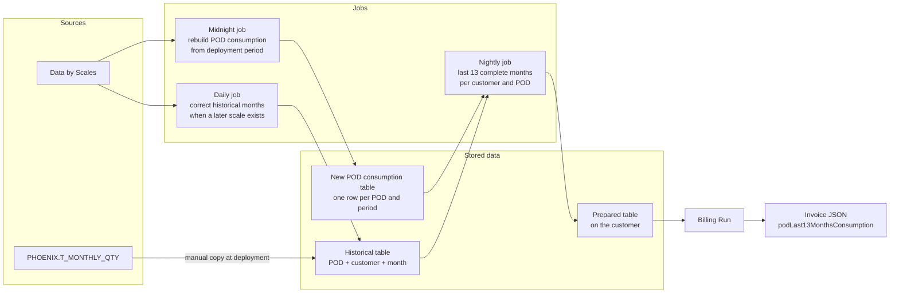
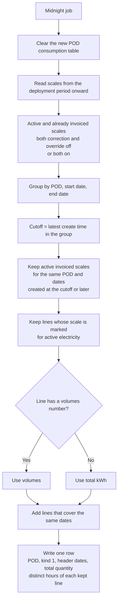
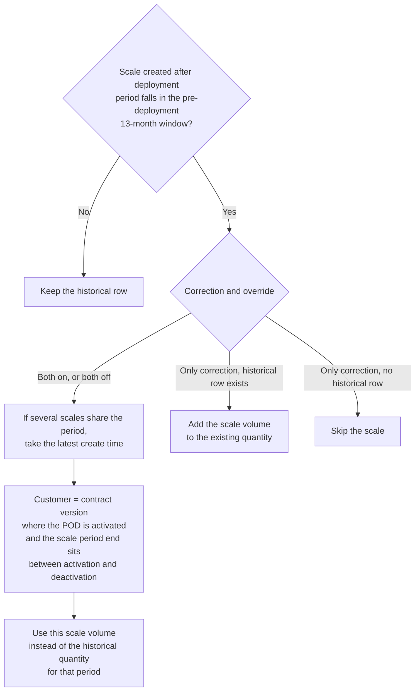
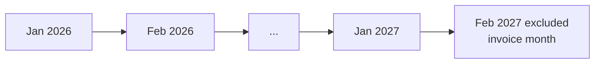
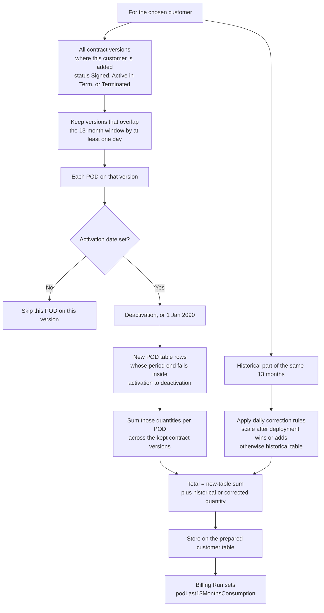

# POD last 13 months consumption — story flow

Source: Confluence page **In the invoices to show consumption history for 13 month** (page ID `1224802306`).

URL: https://asterbit.atlassian.net/wiki/x/AgABSQ

This diagram follows the story text. It is not a runtime trace of Phoenix code.

## 1. End-to-end flow

Three stored places, three jobs, then Billing Run copies a prepared value into the invoice.

Deployment period is an input. The midnight job collects scales only from that period onward. Months before that period come from the historical table, unless a scale created after deployment covers that past month.

## 2. New POD consumption table

One row is one measured period for one point of delivery.

| Column | Meaning |
| --- | --- |
| id | Record ID, assigned automatically |
| pod_id | Point of delivery |
| type | Always scale. Written value is kind 1 |
| period_from | Period start on the scale header |
| period_to | Period end on the scale header |
| total_volume | Sum of kept line quantities for that period |

The story also says each row stores the distinct clock hours covered by the kept lines. Those hours are not listed as a column in AC-1. Quantity is not split across the hours.

## 3. Midnight job — fill the new table from scales

The job clears the new POD consumption table and fills it again. It does not cap the history at 13 months. It starts at the deployment period and does not rewrite the historical table.

For one point of delivery and one pair of header dates, the job writes one row.

A line is ignored when its scale is not marked for active electricity. Scale type, scale name, and tariff name are not filters.

The job does not use difference kWh, correction kWh, deducted kWh, meter readings, or price.

Hours example: a line from 1 June through 30 June stores 1 June 00:00, 1 June 01:00, through 30 June 23:00. A repeated hour is stored once.

## 4. Historical table

After deployment the new table is empty of old scales, so the last 13 months are loaded manually from KVASY into a separate historical table. The nightly scale rebuild must not update that table.

| Field | Source column |
| --- | --- |
| POD identifier | ZNUM |
| Customer number | CUST_NUM in the field list; CUST_IDENT in the copy SQL |
| Consumption kWh | QTY |
| Period, full month and year | PERIOD |

Copy SQL in the story:

`SELECT tmq.ZNUM, tmq.CUST_IDENT, tmq.QTY, tmq.period FROM PHOENIX.T_MONTHLY_QTY tmq`

The historical row is already filtered by customer and month. The new POD table is not.

## 5. Daily correction of a historical month

A scale created in the system after deployment can cover a month inside the 13-month window that sits before the deployment date. That scale replaces or adjusts the historical row. A partial period is attributed to the month of its end date. Example: 15 April–15 May belongs to May.

Deactivation missing means 1 January 2090.

## 6. Window for the variable

The variable is the POD consumption for the last 13 complete months, excluding the month in which the invoice is generated.

Example: invoice generated on 17 February 2027 uses 1 January 2026 through 31 January 2027.

## 7. Nightly job — value per customer and POD

The job runs ahead of Billing Run and stores the result on a prepared customer table. Billing Run reads that value and writes `podLast13MonthsConsumption`. It does not calculate the 13 months itself.

## 8. What each actor does

| Actor | Action |
| --- | --- |
| System user | Receives the invoice that already contains the variable |
| System | Midnight rebuild, daily historical correction, nightly variable calculation, manual historical load |
| Billing Run | Reads the prepared customer value and writes it into the invoice JSON |
